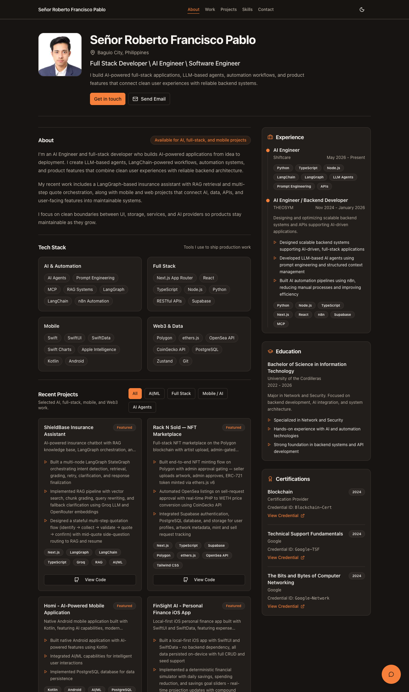

# Señor Roberto Francisco Pablo — AI Engineer Portfolio

Personal portfolio for Señor Roberto Francisco Pablo, an AI engineer working on LLM agents, backend systems and automation.

**Live:** https://francisco-pablo-portfolio.vercel.app



## Stack

- Next.js 16 (App Router), React 19, TypeScript
- Tailwind CSS v4, Radix UI primitives, Framer Motion
- Content as MDX via Contentlayer (`content/`)
- RAG chat: LangGraph + Groq (chat) + OpenRouter (embeddings)
- Contact form via Resend; analytics via Vercel Analytics
- Deployed on Vercel

## How the RAG chat works

The chat widget answers questions about my background using only the site's own content.

1. On first request, `lib/rag/content-docs.ts` splits the MDX content (projects, experience, education and so on) into chunks, and `lib/rag/openrouter-embeddings.ts` embeds them through OpenRouter. The index is held in memory.
2. Each question is embedded and the chunks are ranked by cosine similarity (`lib/rag/chunking.ts`).
3. A LangGraph pipeline (`lib/rag/graph.ts`) reranks the top candidates, then streams a grounded answer from a Groq chat model using the retrieved chunks as context.
4. `app/api/chat/route.ts` exposes the pipeline to the widget.

## Run locally

Requires Node.js 20+.

```bash
npm install
npm run dev      # http://localhost:3000
npm run build    # production build
npm run lint
```

Create `.env.local` with the variables you need:

| Variable | Used for |
| --- | --- |
| `GROQ_API_KEY`, `GROQ_CHAT_MODEL` | RAG chat model (required for chat) |
| `OPENROUTER_API_KEY`, `OPENROUTER_EMBEDDING_MODEL` | RAG chat embeddings (required for chat) |
| `RESEND_API_KEY`, `CONTACT_EMAIL` | Contact form email delivery (optional) |
| `NEXT_PUBLIC_SITE_URL` | Canonical URL for metadata, sitemap and OG image (defaults to the live URL) |
| `NEXT_PUBLIC_GITHUB_USERNAME` | GitHub activity section (optional) |

## Deploy

Import the repo in Vercel, add the variables above under Settings → Environment Variables, and deploy. No other configuration is needed.
